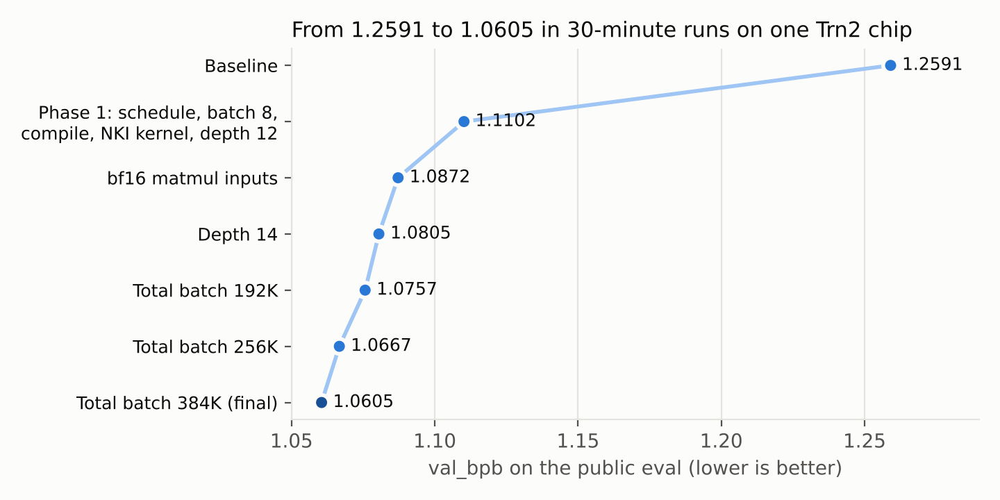
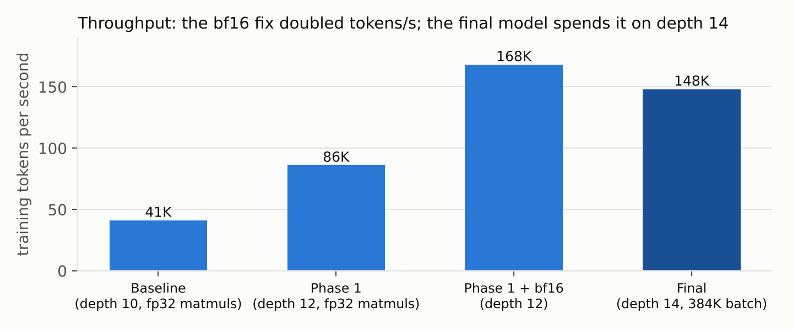
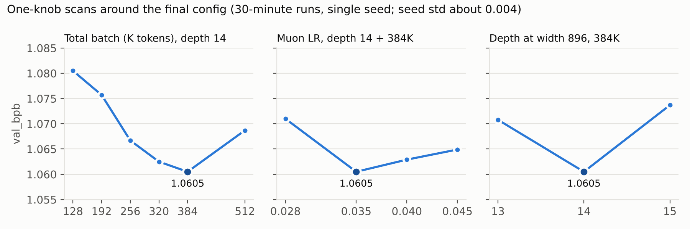

# Training a language model in 30 minutes on one AWS Trainium2 chip

My entry for Round 1 of the [AWS Trainium Frontier](https://trainium-frontier.devpost.com/) challenge. The task was to train a GPT-style language model from scratch on one Trn2 chip within a 30-minute budget, and get the lowest validation bits-per-byte (val_bpb) on a fixed eval.

**Result: val_bpb 1.0605, down from the starter kit's 1.2591** (−0.199). This came from 130 queued experiments over four days.



## Highlights

- **Found a silent precision bug that cost half the chip.** A `[1]`-shaped fp32 scalar multiplied the bf16 residual stream, and PyTorch type promotion kept everything fp32 from there on, so every matmul ran in fp32. I found it with forward hooks that print each Linear's input dtype. Casting Linear inputs to bf16 halved the step time (1.53 to 0.78 s) and gave −0.023 val_bpb at the same config.
- **Wrote an NKI kernel.** It fuses RoPE + QK-RMSNorm, forward and backward, using the fact that rotation preserves the norm. It makes one HBM pass per 128-row tile, runs the forward 37% faster and gives 7% more steps. It was checked against an fp32 reference on CPU and on device.
- **Made the training loop fast.** Device batch 8 instead of 1, `torch.compile` of the model and of a functional Muon/AdamW, and the LR passed as a 0-d device tensor. Neuron's eager mode baked the Python-float LR into kernels and recompiled every step, taking it from 1.5 to 8 s per step. Together with the bf16 fix, throughput went from 41K to 168K tokens/s while the model grew from depth 10 to 12.
- **Spent the speed on scale.** Depth 14 (149.6M params) and 384K tokens per step, chosen by full 30-minute scans of batch size, depth and Muon LR.
- **Ran the experiments like a system.** A runner on the instance pulled a queue from a git branch, ran one job at a time, evaluated it and pushed logs and results back. The chip stayed busy around the clock without an SSH session. Each run is a commit plus env overrides, so it can be reproduced from the table.
- **Found and fixed an evaluation pitfall.** A setting that changes the forward pass but is not saved in the checkpoint was evaluated with its default value. The softcap now lives in the model config.



## Final configuration

| | Baseline | Final |
| --- | --- | --- |
| val_bpb (public eval) | 1.2591 | **1.0605** |
| Model | depth 10, 640 wide, 59.6M params | depth 14, 896 wide, 149.6M params |
| Tokens per optimizer step | 65,536 | 393,216 |
| Steps in 30 min | 1000 | 679 |
| Tokens per second | 41K | 148K |
| Model FLOP/s | — | ~149 TFLOP/s (~22% of BF16 peak) |

The optimizer is Muon for the matrices (Polar Express orthogonalization, cautious weight decay, LR 0.035) and AdamW for embeddings, lm_head and scalars. The LR decays linearly to zero over the last 60% of the time budget.



The remaining bottleneck is device memory: device batch 12/16, depth 16 and U-net skips all fail to allocate at 12 GiB per NeuronCore. The next levers would be a flash-attention NKI kernel and activation checkpointing. See [`REPORT.md`](REPORT.md) for the full analysis.

## Repository layout

| Path | Contents |
| --- | --- |
| `train.py` | Final training script: model, Muon/AdamW, NKI kernels, time-budgeted training loop, `load_for_eval` |
| `baseline/train.py` | The starter kit's original, for diffing |
| `prepare.py`, `requirements.txt`, `artifacts/` | Unmodified starter kit: data, tokenizer, evaluation, submission check |
| `REPORT.md` | Two-page report: what worked, what did not, where step time goes |
| `results.tsv` | All 130 runs: commit, val_bpb, steps, s/step, keep/discard/crash, description |
| `experiments/` | Write-up, raw run table, experiment queue, runner scripts, logs of 37 key runs, figures |

The complete git history, with every `exp/*` branch and the logs of all 130 runs, is in the [competition fork](https://github.com/MapleSugarMochi/trn-r1-test).

## Running it

On a `trn2.3xlarge` with the Neuron training DLAMI (`torch`, `torch_neuronx`, `neuronx-cc`):

```
pip install -r requirements.txt
python prepare.py setup
NEURON_LOGICAL_NC_CONFIG=1 torchrun --standalone --nproc_per_node=8 train.py
python prepare.py eval-public --train-py train.py --checkpoint out/final.pt
```

Every hyperparameter can be overridden with `NEURON_HP_<NAME>`, for example `NEURON_HP_TOTAL_BATCH_SIZE=262144`. See the parameter block at the top of `train.py`.

## Credits and license

Based on the AWS Trainium Frontier Round 1 starter kit, which is licensed under Apache 2.0. `train.py` is modified from the kit; see [`NOTICE`](NOTICE) and [`LICENSE`](LICENSE). Code, experiments and analysis were developed with an AI coding agent (Claude), which also drove the runner queue.

中文简介见 [`README_zh.md`](README_zh.md)。
