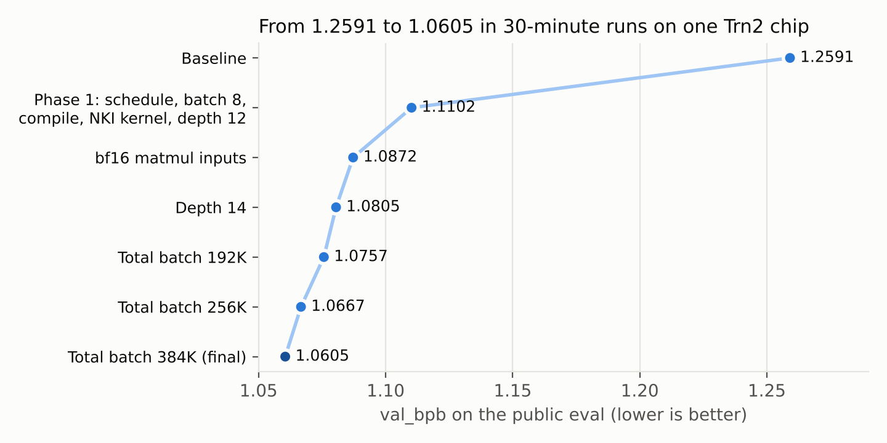
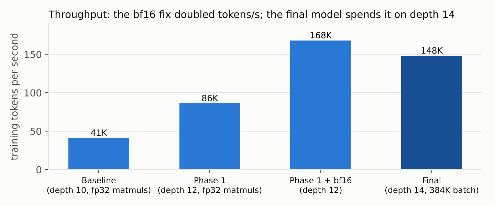
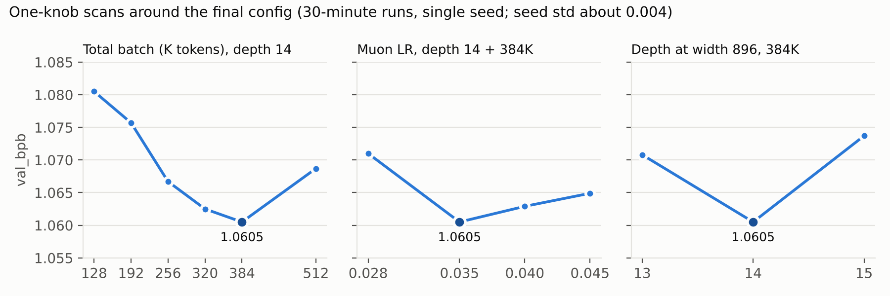

# Experiments

> Commit hashes and branch names below refer to the original development repository, which is not public. The run table, runner scripts and key logs are copied into this folder.

Every experiment behind the submission, gathered in one place. The final result and its explanation are in [`../REPORT.md`](../REPORT.md). The per-run verdicts (keep / discard / crash) are in [`../results.tsv`](../results.tsv).

**Result:** val_bpb **1.0605** on the public eval after a 30-minute run on one Trn2 chip (`lnc=1 × 8`), down from the baseline's 1.2591. The final config is the defaults of `train.py` on `main`.



## What is in this folder

| Path | Contents |
| --- | --- |
| `all_runs.tsv` | Raw table written by the runner: one row per run (130 runs) with run id, commit, branch, launch shape, time budget, extra args, env overrides, val_bpb, steps, s/step, startup, train and eval seconds, status, description. |
| `queue.tsv` | The experiment queue as submitted: run id, git ref, `lnc`, time budget, args, env overrides and the hypothesis each run tested. |
| `logs/<run id>/` | `train.log`, `eval.log` and `meta.txt` for 37 key runs (the chain from baseline to final, plus the informative failures). |
| `tools/agent.sh`, `tools/run_once.sh` | The runner that executed the queue on the instance. |
| `tools/make_results.py` | Builds `../results.tsv` from `all_runs.tsv`. The runner only records `crash` or `keep_pending`; keep vs discard was judged by hand (see Method notes in the report) and is encoded in the script's `KEEP` set. |
| `figures/` | Charts used in this README. |

## How the experiments were run

1. Each idea was implemented on an `exp/*` branch, behind an environment variable (`NEURON_HP_<NAME>`) whenever possible, so one commit could serve many runs.
2. A run was queued by adding a row to `runner/queue.tsv` on the `ops` branch: run id, git ref, `lnc`, time budget, env overrides and the hypothesis.
3. On the instance, `agent.sh` looped every 60 s. It pulled the latest `run_once.sh` from `ops`, and `run_once.sh` ran at most one queued job. Each job ran `torchrun ... train.py` on the given ref, then `prepare.py eval-public` on the saved checkpoint. The script refused any job that could not finish before the instance deadline.
4. Logs and a result row were pushed to the `results` branch (`runs/<id>/`, `all_runs.tsv`, `HEARTBEAT`).
5. A change was kept only if a full 30-minute run beat the current best by 0.008, or by 0.004–0.008 when it was in line with a trend (the batch-size series). Seed-to-seed std is about 0.004.

## Path to the result

| Commit on `main` | Change | Run | val_bpb | s/step |
| --- | --- | --- | --- | --- |
| `92240eb` | Starter kit baseline (depth 10, 64K tokens/step, 1000-step cap) | `manual_baseline_nc1` | 1.2591 | 1.60 |
| `f2a251a` | Time-based warmdown, no step cap, LR as a 0-d device tensor | `sched_wd40_fix` | 1.1930 | 1.58 |
| `f2a251a` | + device batch 8 and `torch.compile` | `sched_b8c` | 1.1474 | 0.75 |
| `9796703` | + compiled Muon and AdamW | `sched_fa` | 1.1349 | 0.59 |
| `9796703` | Depth 12, 128K tokens/step, warmdown 60% | `c_d12` | 1.1241 | 1.65 |
| `deae23f` | + NKI fused RoPE + QK-RMSNorm kernel | `ck_d12` | 1.1207 | 1.54 |
| `94696e7` | Muon LR 0.035 (phase 1 final) | `final_v2` | 1.1102 | 1.52 |
| `1dd580d` | bf16 matmul inputs (fixes fp32 promotion of the residual stream) | `bf16_full` | 1.0872 | 0.78 |
| `1dd580d` | + depth 14 | `bf16_d14` | 1.0805 | 0.99 |
| `bd73202` | + total batch 192K | `f2_tb192k` | 1.0757 | 1.41 |
| `3b8e624` | + total batch 256K | `f2_tb256k` | 1.0667 | 1.82 |
| `0a20a39` | + total batch 384K (default from `637670a`) | **`f3_tb384k`** | **1.0605** | 2.66 |

`87d896f` stores the logit softcap in the checkpoint config. `load_for_eval` used to rebuild the model with the default softcap, so a run trained with a different value scored wrongly. This does not change the final config's behaviour.



## Scans around the final config



| Run | Change from the final config | val_bpb |
| --- | --- | --- |
| `f4_tb512k` | total batch 512K | 1.0687 |
| `f4_384_mlr028` / `f4_384_mlr045` | Muon LR 0.028 / 0.045 | 1.0710 / 1.0649 |
| `f4_384_alr15` | embedding, lm_head and scalar LRs ×1.5 | 1.0748 |
| `f5_sc12` | logit softcap 12 | 1.0614 |
| `f4_384_sc30` | logit softcap 30: **invalid score**, evaluated with softcap 15 before the fix | (1.1123) |
| `f6_d13` / `f6_d15` | depth 13 / 15 at width 896 | 1.0708 / 1.0737 |
| `f2_d16_b4` | depth 16 at device batch 4 (192K) | 1.0784 |
| `f5_unet_b4` | U-net skips at device batch 4 | 1.0847 |
| `f2_d16`, `tp_b16_384` | depth 16 / device batch 16 at device batch 8 | crash: out of device memory |
| `f6_gc1` | gradient clipping 1.0 | crash: `aten::_foreach_norm` does not compile on Neuron |

## Throughput and kernel experiments

| Run | What it measured | Result |
| --- | --- | --- |
| `opbench_d12` | Per-component forward + backward time at training shapes | Attention: sdpa was 75 of 240 ms; the rest motivated the NKI kernel |
| `k_qknorm_d12` | NKI fused RoPE + QK-RMSNorm (self-test + throughput) | Forward 37% faster, 7% more steps |
| `tp_bf16` | bf16 matmul inputs | 1.52 to 0.79 s/step |
| `tp_rms2` | NKI fused RMSNorm (forward + backward) | 0.792 vs 0.788 s/step: no gain, kept off |
| `tp_qkvcat` | Fused QKV matmul | 0.997 vs 0.788 s/step. **Invalid:** the fused path skipped the bf16 input cast, so its matmul ran in fp32 (fixed later, not re-measured) |
| `tp_lnc1_ref` / `tp_lnc2_b8` | Launch shape `lnc=1 × 8` vs `lnc=2 × 4` | 1.42 vs 1.68 s/step |
| `tp_final384` | Per-phase step profile of the final config | 2.70 s/step |

Runs with a 300–900 s budget measure throughput only. Their val_bpb is not comparable to 30-minute runs.

## Branches

| Branch | Purpose |
| --- | --- |
| `main` | Submission: final `train.py`, `REPORT.md`, `results.tsv`, this folder |
| `exp/sched` | Time-based warmdown, LR as a device tensor, seed override |
| `exp/profile`, `exp/profile-v1` | Per-phase step timing (`NEURON_HP_PROFILE=1`) |
| `exp/fastopt` | Functional, compiled Muon and AdamW; bucketed all-reduce (not kept) |
| `exp/opbench` | Per-component timing at training shapes (analysis only) |
| `exp/nki-qknorm`, `exp/nki-qknorm2` | NKI fused RoPE + QK-RMSNorm kernel; `[B,H,T,D]` output variant (not kept) |
| `exp/final` | Phase 1 final config (1.1102) |
| `exp/arch` | Value residual, U-net skips, fused QKV, 1-sqrt warmdown (all optional, none kept) |
| `exp/nki-rmsnorm` | NKI fused RMSNorm kernels and bf16 matmul inputs |
| `exp/final2` | Phase 2 final config, same as `main` |
| `exp/softcap` | Logit softcap stored in the checkpoint config |
| `ops` | Runner and experiment queue (not part of the submission) |
| `results` | Logs and the result table for every run, written by the runner |

## Reproducing a run

Final config (the defaults on `main`):

```
NEURON_LOGICAL_NC_CONFIG=1 torchrun --standalone --nproc_per_node=8 train.py
python prepare.py eval-public --train-py train.py --checkpoint <out-dir>/final.pt
```

Most other runs: prefix the same command with the run's `env` column from `all_runs.tsv`; the knobs used in phase 2 all exist in the final `train.py`. For example, `f4_tb512k`:

```
NEURON_HP_TOTAL_BATCH_SIZE=524288 NEURON_LOGICAL_NC_CONFIG=1 torchrun --standalone --nproc_per_node=8 train.py
```

Phase 1 runs used earlier versions of `train.py`; their commits are in the non-public development repository.

Runs are deterministic for a given config and seed. Time-based stopping can shift the step count by a few steps (about ±0.001 val_bpb).
